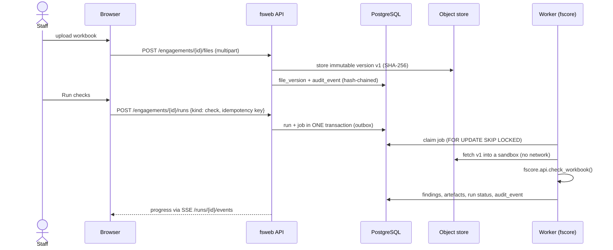
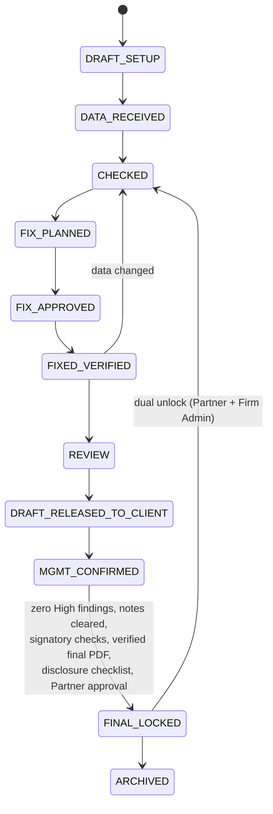

# FS-Platform architecture

FS-Platform prepares (Module P) and reviews (Module R) Ind AS financial statements for a Chartered
Accountancy firm. Users work in a browser from anywhere; all processing runs on the firm's own
infrastructure. Client data leaves only as an explicitly approved, pseudonymised AI payload.

## Components

```mermaid
flowchart TB
  subgraph Users
    B[Browser SPA<br/>React + TypeScript]
    L[Mode C laptop<br/>fsoffline on 127.0.0.1]
  end
  subgraph Edge
    CF[Cloudflare Tunnel<br/>outbound only]
    CA[Caddy<br/>TLS, HSTS, CSP, rate limits, allow-lists]
  end
  subgraph Internal["internal network (no internet route)"]
    API[fsweb API ×N<br/>FastAPI, RBAC + ABAC, sessions in DB]
    W[Job workers ×N<br/>fscore engine + LibreOffice]
    PG[(PostgreSQL 16<br/>RLS, audit chain, job outbox)]
    S3[(MinIO / S3<br/>versions, object lock)]
    R[(Redis<br/>HA profile only)]
  end
  AIG[ai-gateway<br/>only egress]
  WIN[Windows render pool<br/>fsrender-win + licensed Excel]
  BK[Backups<br/>pgBackRest + restic → NAS + India-region object lock]
  MON[Prometheus · Alertmanager · Loki · Tempo · Grafana]
  AI[(AI provider<br/>approved region)]

  B --> CF --> CA --> API
  L -. .fspkg packages .-> API
  API --> PG
  API --> S3
  API --> R
  W --> PG
  W --> S3
  AIG --> PG
  AIG -- approved payload only --> AI
  WIN -- pull jobs over HTTPS --> CA
  PG --> BK
  S3 --> BK
  API --> MON
  W --> MON
```

| Component | Code | Responsibility |
|---|---|---|
| Engine | `fscore/` | workbook reader, number-format renderer, formula evaluator, check catalogue (CAST … MULTI), fix planner, OOXML patcher, PDF render + reconciliation, Module P, AI payload builder. Pure Python, no web dependencies, used by CLI, web and offline (D3). |
| Web platform | `fsweb/` | auth + MFA, RBAC + ABAC + PostgreSQL RLS, engagements and state machine, files and immutable versions, jobs (transactional outbox), maker-checker, review notes, hash-chained audit trail, AI gate, admin and compliance. Never re-implements engine logic. |
| UI | `fsui/` | React SPA: dashboard, engagement workspace (files, checks, fix plan, narrative, RPT grid, PDF, review notes, audit), client portal, admin. |
| Render worker | `fsrender-win/` | Windows service that pulls render jobs and exports PDFs with Excel COM (watchdog, one Excel per job). |
| Offline edition | `fsoffline/` | Mode C launcher: SQLite + local storage + in-process worker on loopback. |
| Operations | `ops/` | Compose and Helm deployments, Caddy, backups, monitoring, runbooks, IaC, ITGC procedures. |

## Job flow: "Run checks" (04 §5)



*Propose fixes* → a plan with a SHA-256; a **different user** approves it (C2); *Apply* writes **v2**
through surgical OOXML patching and post-write verification (C5); a render job produces the PDF and the
PDF-vs-workbook reconciliation (C7). Any data change after `FIXED_VERIFIED` returns the engagement to
`CHECKED`.

## Engagement lifecycle (06 §1)



## Deployment modes (04 §2)

| Mode | User sees | Runs where | Status |
|---|---|---|---|
| A. Firm-hosted web app | `https://fs.<firm-domain>` with MFA | firm server(s): `ops/docker-compose.yml` or `ops/helm/fs-platform` | primary |
| B. Published desktop (RemoteApp) | Excel on the server beside the app | Windows Server with RDS + Excel | T2 (ADR-0004) |
| C. Offline single PC | same UI on `http://127.0.0.1:<port>` | the user's laptop (`fsoffline`) | packages-only sync |

## Profiles

- **Single node** (go-live): one Linux host + one Windows render VM; Redis optional; backups to NAS and an
  India-region object-locked bucket.
- **HA** (E-ARCH-01): load balancer, 2+ stateless API pods (HPA, PDB), PostgreSQL primary + synchronous
  standby with automatic failover, Redis Sentinel, distributed MinIO, render pool ≥ 2, DR site (T2).

Both profiles run the same images and pass the same test suite (12 §3).

## Security architecture in one paragraph

TLS at the edge, HSTS and a strict CSP; no inbound ports (tunnel); internal services without internet
route; RBAC on every endpoint plus ABAC policies plus PostgreSQL row-level security for the runtime role;
MFA for every user; field-level envelope encryption for identifiers; immutable versions and object-locked
finals; a hash-chained, append-only audit trail verified nightly; logs without client data, retained 180
days in India; AI egress through one gateway with payload-hash-bound approvals. Details:
`docs/security/threat-model.md`.
